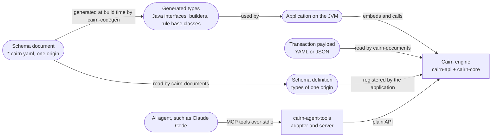
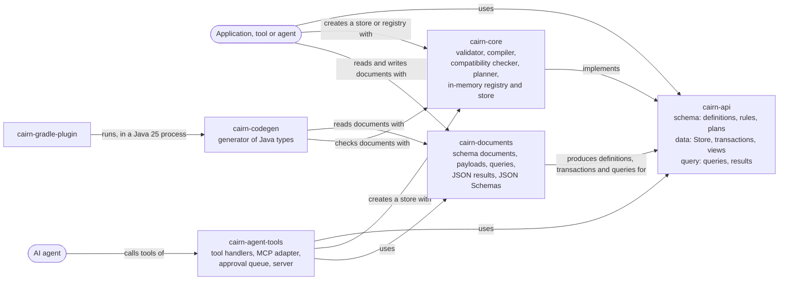
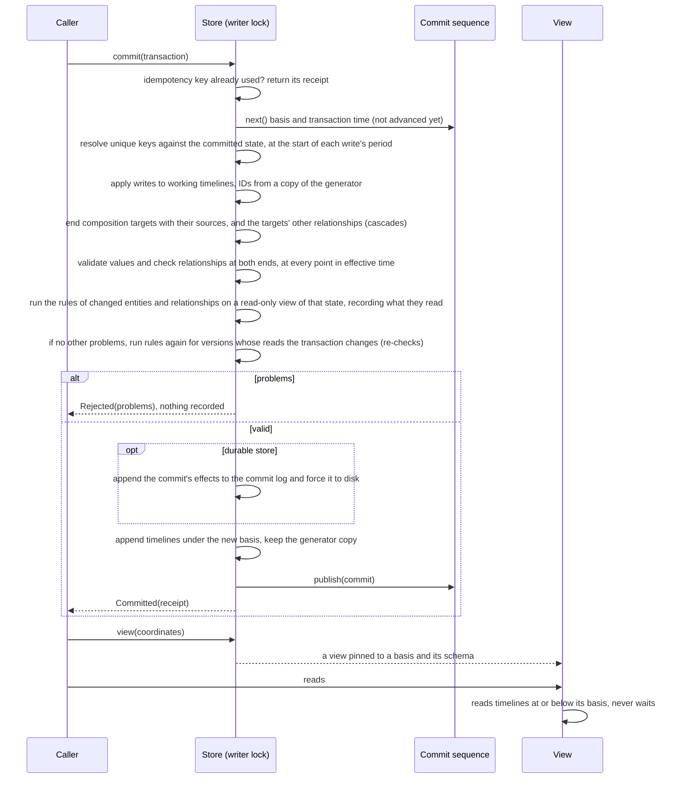

# Architecture overview

This page describes the system as it is now, using the [arc42](https://arc42.org/overview) section numbering, trimmed. Diagrams follow the [C4 model](https://c4model.com/) and are written as Mermaid flowcharts, which GitHub and Obsidian both render. Mermaid's dedicated C4 syntax is still experimental.
It is a living document: update it in the same pull request that changes the architecture, and bump `last-reviewed`.

> [!NOTE]
> **Current state:** the schema API is built: defining, validating, planning, registering and evolving types (the `type-model` and `schema-evolution` capabilities), and schema documents (`schema-documents`). Entities and relationships are stored in memory with history on two time axes (`transactions`, `entity-versions`, `views`, `relationships`), and Java rules run at commit, and again when a transaction changes what they read (`entity-rules`). Payloads and JSON results for agents are in `cairn-documents` (`json-payloads`), and `cairn-agent-tools` serves a store to agents as tools of the Model Context Protocol, under an approval policy (`agent-tools`). Java types are generated from schema documents by `cairn-codegen` and the Gradle plugin in `cairn-gradle-plugin` (`java-types`). Stores can be kept on disk through a commit log and snapshot files, and recover after a restart or a crash (`durability`). Views run queries: filters, follow steps, traversals, grouping and aggregates, built in Java, with generated types or as JSON (`queries`). Entities can be purged from all of history, for legal erasure (`purge`). A key-value store is not built yet. The intended design is in accepted ADRs, listed under [solution strategy](#4-solution-strategy), and explored in the [API research note](../research/2026-10-12-graph-system-of-record-api.md) and the [AI-native research note](../research/2026-10-13-ai-native-schema-and-rules.md). Write "n/a" for sections that do not apply yet instead of deleting them.
> Split a section into its own file in this folder when it outgrows a screen, and link it from here.

## 1. Introduction and goals

<!-- Link the product overview; list the three to five quality goals that drive the architecture, in priority order. -->

| Priority | Quality goal | Scenario that makes it measurable |
| --- | --- | --- |
| 1 | *tbd* | *tbd* |

## 2. Constraints

<!-- Technical, organizational and regulatory constraints. Link the ADR that introduced each one. -->

- Implementation language: Java 25, see [ADR-0005](../decisions/0005-choose-primary-implementation-language.md). Built with Gradle, see [ADR-0015](../decisions/0015-build-the-java-code-with-gradle.md). CI also runs the build on the newest Java release, without blocking.

## 3. Context and scope

<!-- C4 level 1: the system, its users and the external systems it talks to. -->

Cairn runs inside the application's JVM ([ADR-0007](../decisions/0007-run-sysrec-as-an-embedded-single-node-engine-with-a-single-writer.md)). It has no external systems yet.
AI agents reach it through text formats over the same API ([ADR-0017](../decisions/0017-design-cairn-so-that-ai-agents-are-first-class-users.md)): schema documents, transaction payloads, queries, JSON results and JSON Schemas, in `cairn-documents`. `cairn-agent-tools` serves these to agents as tools of the Model Context Protocol, either embedded in an application or as a server on standard input and output; see the guide [Serve a store to AI agents](../guides/serve-a-store-to-ai-agents.md).

## 4. Solution strategy

<!-- The handful of fundamental choices (style, stack, key patterns), each linking to its ADR. -->

Accepted, and built one change at a time:

- An embedded engine on one node, with a single writer and snapshot readers: [ADR-0007](../decisions/0007-run-sysrec-as-an-embedded-single-node-engine-with-a-single-writer.md)
- History on two time axes, effective time and transaction time: [ADR-0008](../decisions/0008-record-history-on-two-time-axes-effective-time-and-transaction-time.md)
- Versions of whole entities: [ADR-0009](../decisions/0009-version-whole-entities-rather-than-single-attributes.md)
- A typed property graph with single inheritance and traits: [ADR-0010](../decisions/0010-model-data-as-a-typed-property-graph-with-single-inheritance-and-traits.md)
- Storage behind an ordered key-value store and a commit log, with the in-memory implementation as the reference: [ADR-0011](../decisions/0011-hide-storage-behind-an-ordered-key-value-store-and-a-commit-log.md)
- Types defined in schema documents, with Java types generated from them: [ADR-0012](../decisions/0012-define-types-as-annotated-java-interfaces-processed-at-compile-time.md)
- AI agents as first-class users: [ADR-0017](../decisions/0017-design-cairn-so-that-ai-agents-are-first-class-users.md)
- Declarative constraints, plus validation rules written in Java: [ADR-0018](../decisions/0018-validate-with-declarative-constraints-and-named-java-rules.md)
- Reads through immutable views; feature flags resolved by the caller: [ADR-0013](../decisions/0013-read-through-immutable-views-and-take-feature-flags-resolved-by-the-caller.md)
- Opaque entity IDs from one generator per store, UUIDv7 by default: [ADR-0019](../decisions/0019-identify-entities-by-opaque-ids-from-one-generator-per-store.md)
- Patterns written as I-Regexp and matched in linear time: [ADR-0020](../decisions/0020-write-attribute-patterns-as-i-regexp-and-match-them-in-linear-time.md)
- Purges that remove entities from all of history, the one exception to immutability: [ADR-0024](../decisions/0024-purge-entities-by-removing-them-from-all-of-history-and-record-that-a-purge-happened.md)
- Queries as data, a pipeline of steps over named bindings: [ADR-0023](../decisions/0023-express-queries-as-data-a-pipeline-of-steps-over-named-bindings-with-a-java-builder-and-a-json-form.md)
- Entities named and found by unique keys, resolved at commit: [ADR-0026](../decisions/0026-refer-to-entities-by-unique-keys-resolved-at-commit.md)
- Rules run again when the data they read changes: [ADR-0025](../decisions/0025-run-a-rule-again-when-the-data-it-read-changes.md)
- Durable stores through a commit log of effects and snapshot files: [ADR-0022](../decisions/0022-make-stores-durable-with-a-commit-log-of-effects-and-snapshots.md)
- Generated Java types as interfaces with snapshot records, builders of writes and rule base classes: [ADR-0021](../decisions/0021-generate-java-types-as-interfaces-with-snapshot-records-builders-of-writes-and-rule-base-classes.md)

## 5. Building block view

<!-- C4 level 2: containers and main components. Map each to the capabilities in openspec/specs it implements. -->

| Building block | Responsibility | Capabilities (specs) |
| --- | --- | --- |
| `cairn-api` | Public types: schema definitions and their builders, the resolved schema with descriptions, constraints and rule references, rule descriptors, problems with their details, explained codes and document locations, plans, stored definitions, identifiers, origins, submissions (who and why of a schema change) and the `SchemaRegistry` interface (package `schema`); stores and durable stores, transactions and their writes, receipts, IDs and unique keys, effective periods, views and entity states, relationship states, links and traversal steps, the rule interfaces `Rule`, `EntityRule`, `RelationshipRule` and `RuleContext`, and what generated types build on: `TypedEntity`, `TypedRelationship` and `TypedValues` (package `data`); queries, their results and typed references (package `query`). No dependencies. Its test fixtures hold the reference domain model, its rules, stories and queries, and a settable test clock. | `type-model`, `schema-evolution`, `schema-documents`, `transactions`, `entity-versions`, `views`, `entity-rules`, `relationships`, `java-types`, `queries` |
| `cairn-core` | The engine. Validates definitions against each other and the available rules, compiles them into a resolved schema with schema identifiers, checks compatibility, plans registrations, checks and matches patterns (I-Regexp, with RE2/J), and keeps the in-memory schema registry with its history. Runs the in-memory store: one writer resolves the unique keys that writes name, at the start of each write's period, then applies and validates transactions against the state they would produce, ends composition targets with their sources, and the targets' other relationships, checks relationships at both ends (types, lifetimes, multiplicities, duplicates), runs the Java rules that changed entities and relationships name, which read that state through a read-only view, records what each rule read, and runs a rule again for the versions whose reads a transaction changes ([ADR-0025](../decisions/0025-run-a-rule-again-when-the-data-it-read-changes.md)), and appends a timeline per entity, relationship and basis; views read, navigate, traverse and run queries at their basis without waiting; a query is checked against the view's schema first, then its steps scan and join in memory, and its rows are ordered by the query, then by IDs, so that every store returns them alike. Purges remove entities, their relationships and composition targets from every basis, under the writer lock, and keep a record ([ADR-0024](../decisions/0024-purge-entities-by-removing-them-from-all-of-history-and-record-that-a-purge-happened.md)). Finds rules through `ServiceLoader` when asked. A durable store wraps the same in-memory store: it writes each commit's effects to a commit log in its directory, forced to disk before the commit is published, writes snapshot files without stopping commits, and recovers from the newest valid snapshot file and the log after it, without validating or running rules, then runs its rules once to learn what they read ([ADR-0022](../decisions/0022-make-stores-durable-with-a-commit-log-of-effects-and-snapshots.md)). Exports only `SchemaRegistries`, `Stores`, `StoreSettings` and `IdGenerators`; everything else is internal. Its only runtime dependency is RE2/J ([ADR-0020](../decisions/0020-write-attribute-patterns-as-i-regexp-and-match-them-in-linear-time.md)). | `type-model`, `schema-evolution`, `transactions`, `entity-versions`, `views`, `entity-rules`, `relationships`, `durability`, `queries`, `purge` |
| `cairn-documents` | Schema documents ([ADR-0012](../decisions/0012-define-types-as-annotated-java-interfaces-processed-at-compile-time.md)): reads YAML 1.2 (and JSON) strictly into an origin and a schema definition, locates every problem in the document, writes definitions as YAML or JSON, and publishes the JSON Schema of the format. Reads transaction payloads (YAML 1.2 or JSON) with their problems located in them, resolving the unique keys they name through an `IdLookup` to locate problems and type values, writes receipts, states, links, steps and problems as JSON, and generates JSON Schemas for the values of each type and for payloads. Reads queries (JSON or YAML) with located problems, publishes their JSON Schema, and writes query results as JSON. `NamedRules` finds the rules that documents name, and the closest common supertype of the types that name each, for the generator and the agent server. Depends on `cairn-api` and SnakeYAML Engine, not on `cairn-core`. | `schema-documents`, `json-payloads`, `queries` |
| `cairn-codegen` | The generator of Java types ([ADR-0021](../decisions/0021-generate-java-types-as-interfaces-with-snapshot-records-builders-of-writes-and-rule-base-classes.md)): reads schema documents, checks them together in an in-memory schema registry, and writes an interface for every type, with a typed reference per attribute, a snapshot record and builders for entity and relationship types, and a base class for every rule the documents name, and a `by<Attribute>` method per unique attribute that makes a unique key. Runs from the command line. The code it generates depends on `cairn-api` only (`TypedEntity`, `TypedRelationship`, `TypedValues`). Depends on `cairn-documents` and `cairn-core`. | `java-types` |
| `cairn-gradle-plugin` | The Gradle plugin `io.github.enricoag1982.cairn.types`: generates a project's types before its Java code compiles, by running `cairn-codegen` on Java 25 in a process of its own. Compiled for Java 17, the oldest Java that runs Gradle 9, with no dependency on Cairn's classes. | `java-types` |
| `cairn-agent-tools` | The adapter for AI agents ([ADR-0017](../decisions/0017-design-cairn-so-that-ai-agents-are-first-class-users.md)): `AgentTools` holds one handler per tool, taking and returning JSON text over a store, and `McpAdapter` registers them with the MCP Java SDK's server. `AgentPolicy` says whether an agent's registrations and commits are allowed, wait in the `ApprovalQueue` for a person, or are denied. The adapter records its principal on every transaction. `CairnAgentServer` runs an in-memory store from schema documents over standard input and output. Depends on `cairn-core`, `cairn-documents` and the MCP Java SDK, which brings Jackson, Reactor, SLF4J and a JSON Schema validator into this subproject only. It runs on the class path, because the SDK's jars have no valid module names: its internals are package-private, and it is trusted to use only what `cairn-core` exports, which the module system does not enforce there. | `agent-tools` |
| `cairn-example-hr` | An example application and the end-to-end test of the platform: the [HR domain](../reference/hr-domain.md), with its schema document, generated types, Java rules and data, built on the public API. Depends on `cairn-api` and `cairn-documents`; its tests also use `cairn-core` and `cairn-agent-tools`. | none |
| `build-logic` | Gradle convention plugins ([ADR-0015](../decisions/0015-build-the-java-code-with-gradle.md)): `cairn.java-library` for every Java module, `cairn.reference-domain-tests` and `cairn.hr-domain-tests` for modules whose tests read the reference domain page or its schema document, or the HR domain page, `cairn.gradle-plugin` for Gradle plugins (Java 17, TestKit tests with the generator's class path), `cairn.reference-types`, which generates the reference domain's types for typed tests, and `cairn.generated-types`, which generates a project's types from its own schema documents, as the Gradle plugin does for applications. Modules with a `module-info.java` get their whole compile classpath as module path, so that automatic modules such as RE2/J are found; `cairn-agent-tools` and `cairn-gradle-plugin` have none and stay on the class path. | none |

## 6. Runtime view

<!-- Sequence diagrams for the few flows that matter most. -->

A commit, in the in-memory store ([ADR-0007](../decisions/0007-run-sysrec-as-an-embedded-single-node-engine-with-a-single-writer.md), [ADR-0008](../decisions/0008-record-history-on-two-time-axes-effective-time-and-transaction-time.md)):

A dry run follows the same path and stops before appending: it records nothing, uses no basis, reserves no ID and leaves the reads of rules as they were. A commit replaces the reads of the versions its rules checked.
Opening a durable store recovers before the store is returned: it reads the newest valid snapshot file, applies the log records after it, drops what a crash left at the end of the log, checks that the ID generator accepts the recovered IDs, and resumes the commit sequence after the last basis and transaction time. Then it runs each rule it has code for once over every version whose type names it, to learn what the rule reads, without judging the results ([ADR-0025](../decisions/0025-run-a-rule-again-when-the-data-it-read-changes.md)).

## 7. Deployment view

<!-- Environments, infrastructure, how artifacts are built and released. -->

Cairn is a set of libraries that an application embeds, keeping its data in memory or in a directory ([guide](../guides/run-a-durable-store.md)), and a Gradle plugin that generates Java types at build time ([guide](../guides/generate-java-types.md)); nothing is released yet. The generator also runs from the command line, and the agent server is the one packaged program: `./gradlew :cairn-agent-tools:installDist` builds a start script and its jars, which an MCP client starts as a local process ([guide](../guides/serve-a-store-to-ai-agents.md)).

## 8. Cross-cutting concepts

<!-- Error handling, security, observability, persistence, configuration, testing strategy. -->

- **Errors:** bad data never throws. Registrations, plans, reading schema documents and payloads, commits and dry runs return a result that lists every problem, each with a stable code, a path and, where it helps, the expected value, the found value, a hint, its location in the document or payload and the code of the rule that reported it. A rule that fails is reported as a problem too. Agent tools never fail the protocol call for bad input: they return the problems as JSON, with `@arguments.<name>` as the path of a problem with an argument. Exceptions mean programming errors in the caller's code: a missing value, a blank temporary ID, a `Multiplicity` other than 0 or 1 to 1 or unbounded, listing a type or navigating or traversing by a name that the view's schema does not have, finding by a unique key that the schema does not allow, a negative traversal depth, asking for the JSON Schema of a type the schema does not have, the same rule given twice or a rule without a description, a rule that the service loader cannot load, or a write attempted from inside a rule; and reading a state as a generated type that it is not, or one that lacks a required value or has a value of another type. Reading and running queries, and purges, return problems too; a `Purge` that names no entity or has a blank principal or reason throws, as a programming error; query records throw only for a negative limit or depth, as programming errors. A durable store also throws when its files fail: an input or output error, a directory that another store holds, damage, an unknown format version, or an ID generator that does not accept the IDs it holds; after a failed write it refuses commits until it is opened again, and after `close` it refuses every call.
- **Concurrency:** schema registrations and data commits of a store share one writer lock and one commit sequence (the single writer). Committed data is appended and then published through the latest basis, so readers never lock and never see a partial commit. Rules run on the writer thread, may only read, and must be thread-safe, because stores that share settings call them concurrently; the store refuses writes while rules run. A durable store forces each commit to disk while it holds the writer lock, so writers wait for the disk; it writes snapshot files from published state without the writer lock. A purge is the exception to readers never seeing a partial change: it takes the snapshot lock, then the writer lock, removes relationships before entities so that a single lookup never finds a relationship without its end, and in a durable store writes its snapshot file under both locks; a view reading during a purge may see part of it.
- **Security:** there is no access control yet. Agents act as the principal their adapter is configured with, which every transaction records, and the approval policy decides what they may change on their own. The agent server is for trusted, local use.
- **Time:** transaction times come from an injected clock, have microsecond precision and strictly increase, across schema and data transactions, and across the openings of a durable store, even if the clock went back. Effective periods are half-open UTC instants with microsecond precision.
- **Testing:** each spec scenario has one test whose display name is the scenario's name. `ReferenceModelTest` keeps the reference model fixture in step with the [reference domain](../reference/reference-domain.md), and `ReferenceModelDocumentTest` keeps its schema document in step with the fixture. `JsonSchemaDriftTest` keeps the published JSON Schema in step with the reader, and `TransactionSchemaTest` the generated payload schema with the payload reader. `EcmaScriptPatternsTest` checks that `cairn-documents` translates patterns as the engine does, and `ReferenceStoryPayloadsTest` that every reference story written as a payload is valid against the generated schema and reads back. `ReferenceStoriesTest` keeps `ReferenceStories` in step with the story table of the reference domain. `cairn-codegen` compiles the code it generates in its tests with all lint warnings as errors, and its typed tests use the reference domain's generated types against the in-memory store; `cairn-gradle-plugin` runs real builds with Gradle TestKit, one of them with Gradle on an older Java when the machine has Java 17 to 24. Durable stores are compared with in-memory twins that committed the same transactions, through every reference story and random operations, before and after reopening; their crash and damage tests cut, zero and alter the bytes of their files. `cairn-example-hr` tests the platform end to end, from outside, on the [HR domain](../reference/hr-domain.md): a fictional company built on the public API with a schema document, generated types, Java rules found through the service loader, payloads, queries, purges, a durable store and the agent tools, with stories replayed in recording order and a generated company of 40 employees. `ReferenceQueries` holds the reference domain's queries, which the builder, generated types and the JSON form must answer alike; `QuerySchemaDriftTest` keeps the query JSON Schema in step with the reader, and `QueryLiteralAgreementTest` the engine's reading of date and instant literals with the documents'. `AgentTaskSuiteTest` scripts what agents do through the tools only, using nothing but what the tools return, and one task goes through the MCP layer. Tests run with compact object headers on.

## 9. Architecture decisions

See the [decision log](../decisions/README.md). This page only links to ADRs; it never repeats their reasoning.

## 10. Quality requirements

<!-- Concrete quality scenarios beyond the top goals in section 1. Testable ones should become OpenSpec requirements. -->

## 11. Risks and technical debt

| Risk or debt | Impact | Mitigation or tracking issue |
| --- | --- | --- |
| A purge rewrites every file of a durable store under the writer lock | Commits wait while a purge runs; results reported before a purge cannot always be reproduced after it | Purges are rare and privileged, and each leaves a purge record |
| Every commit of a durable store is forced to disk | Commits are as fast as the disk syncs | Grouping commits later, behind the same API ([ADR-0022](../decisions/0022-make-stores-durable-with-a-commit-log-of-effects-and-snapshots.md)) |
| Log and snapshot files hold whole timelines per basis | Their size grows with the square of an entity's number of versions | The key-value store of ADR-0011 stores versions once |
| The reads of rules are kept in memory, not in files | Memory grows with what every version's last check read; a durable store runs every rule once when it opens, so opening slows as data grows | Keeping reads in files can follow without changing behavior ([ADR-0025](../decisions/0025-run-a-rule-again-when-the-data-it-read-changes.md)) |
| Rules run inside the single writer | A slow rule, or one that reads much data, slows every commit, also when a change elsewhere runs it again ([ADR-0018](../decisions/0018-validate-with-declarative-constraints-and-named-java-rules.md), [ADR-0025](../decisions/0025-run-a-rule-again-when-the-data-it-read-changes.md)) | Keep rules small; measure commit times with rules on a durable store before production use |
| People approve agents' requests only through the Java API | The standalone agent server cannot have requests approved; approval needs an application that embeds the adapter | A way for people to decide requests comes with access control |
| Generated code knows type names as of generation | `T.from(state)` reads a subtype registered later as the type the caller asks for; aliases of renamed types are not recognized | `T.from(state, schema)` reads it as its nearest known supertype ([ADR-0021](../decisions/0021-generate-java-types-as-interfaces-with-snapshot-records-builders-of-writes-and-rule-base-classes.md)); regenerate types after renames |
| No access control | Any agent connected to a server can read everything the store holds | The guide limits the server to trusted, local use |
| Queries scan the entities of their start type, and join along relationships in memory | Queries over large stores are slow | Indexes come with the key-value store ([ADR-0011](../decisions/0011-hide-storage-behind-an-ordered-key-value-store-and-a-commit-log.md)), without changing results |
| The in-memory store scans for uniqueness, unique keys, listings, relationship integrity, cascades, navigation and traversal | Large stores and large single transactions are slow | Indexes come with the storage interface ([ADR-0011](../decisions/0011-hide-storage-behind-an-ordered-key-value-store-and-a-commit-log.md)) |

## 12. Glossary

See the [glossary](../glossary.md).
