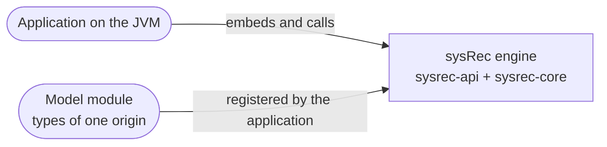
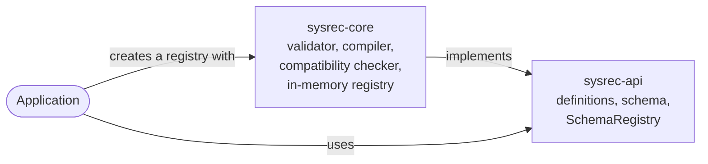

# Architecture overview

This page describes the system as it is now, using the [arc42](https://arc42.org/overview) section numbering, trimmed. Diagrams follow the [C4 model](https://c4model.com/) and are written as Mermaid flowcharts, which GitHub and Obsidian both render. Mermaid's dedicated C4 syntax is still experimental.
It is a living document: update it in the same pull request that changes the architecture, and bump `last-reviewed`.

> [!NOTE]
> **Current state:** only the schema API is built: defining, validating, registering and evolving types (the OpenSpec change `add-type-model`). Entities, relationships, storage and queries are not built yet. The intended design is in `proposed` ADRs, listed under [solution strategy](#4-solution-strategy), and explored in the [API research note](../research/2026-10-12-graph-system-of-record-api.md). Write "n/a" for sections that do not apply yet instead of deleting them.
> Split a section into its own file in this folder when it outgrows a screen, and link it from here.

## 1. Introduction and goals

<!-- Link the product overview; list the three to five quality goals that drive the architecture, in priority order. -->

| Priority | Quality goal | Scenario that makes it measurable |
| --- | --- | --- |
| 1 | *tbd* | *tbd* |

## 2. Constraints

<!-- Technical, organizational and regulatory constraints. Link the ADR that introduced each one. -->

- Implementation language: Java 25, see [ADR-0005](../decisions/0005-choose-primary-implementation-language.md). Built with Gradle, see [ADR-0015](../decisions/0015-build-the-java-code-with-gradle.md). CI also runs the build on the newest Java release, without blocking.

## 3. Context and scope

<!-- C4 level 1: the system, its users and the external systems it talks to. -->

sysRec runs inside the application's JVM ([ADR-0007](../decisions/0007-run-sysrec-as-an-embedded-single-node-engine-with-a-single-writer.md), proposed). It has no external systems yet.

## 4. Solution strategy

<!-- The handful of fundamental choices (style, stack, key patterns), each linking to its ADR. -->

Proposed, not yet accepted:

- An embedded engine on one node, with a single writer and snapshot readers: [ADR-0007](../decisions/0007-run-sysrec-as-an-embedded-single-node-engine-with-a-single-writer.md)
- History on two time axes, effective time and transaction time: [ADR-0008](../decisions/0008-record-history-on-two-time-axes-effective-time-and-transaction-time.md)
- Versions of whole entities: [ADR-0009](../decisions/0009-version-whole-entities-rather-than-single-attributes.md)
- A typed property graph with single inheritance and traits: [ADR-0010](../decisions/0010-model-data-as-a-typed-property-graph-with-single-inheritance-and-traits.md)
- Storage behind an ordered key-value store and a commit log, with the in-memory implementation as the reference: [ADR-0011](../decisions/0011-hide-storage-behind-an-ordered-key-value-store-and-a-commit-log.md)
- Types defined as annotated Java interfaces: [ADR-0012](../decisions/0012-define-types-as-annotated-java-interfaces-processed-at-compile-time.md)
- Reads through immutable views; feature flags resolved by the caller: [ADR-0013](../decisions/0013-read-through-immutable-views-and-take-feature-flags-resolved-by-the-caller.md)

## 5. Building block view

<!-- C4 level 2: containers and main components. Map each to the capabilities in openspec/specs it implements. -->

| Building block | Responsibility | Capabilities (specs) |
| --- | --- | --- |
| `sysrec-api` | Public types: schema definitions and their builders, the resolved schema, problems, identifiers, origins and the `SchemaRegistry` interface. No dependencies. Its test fixtures hold the reference domain model. | `type-model`, `schema-evolution` |
| `sysrec-core` | The engine. Validates definitions, compiles them into a resolved schema with schema identifiers, checks compatibility, and keeps the in-memory schema registry with its history. Exports only `SchemaRegistries`; everything else is internal. | `type-model`, `schema-evolution` |
| `build-logic` | The Gradle convention plugin shared by all Java modules ([ADR-0015](../decisions/0015-build-the-java-code-with-gradle.md)). | none |

## 6. Runtime view

<!-- Sequence diagrams for the few flows that matter most. -->

## 7. Deployment view

<!-- Environments, infrastructure, how artifacts are built and released. -->

## 8. Cross-cutting concepts

<!-- Error handling, security, observability, persistence, configuration, testing strategy. -->

- **Errors:** an invalid schema definition never causes an exception. Registrations return a result that lists every problem, each with a stable code and a path. Exceptions mean programming errors: a missing value, or a `Multiplicity` other than 0 or 1 to 1 or unbounded.
- **Concurrency:** registrations are serialized (the single writer). Each one publishes a new immutable state, so reads never lock.
- **Time:** transaction times come from an injected clock, have microsecond precision and strictly increase.
- **Testing:** each spec scenario has one test whose display name is the scenario's name. `ReferenceModelTest` keeps the reference model fixture in step with the [reference domain](../reference/reference-domain.md). Tests run with compact object headers on.

## 9. Architecture decisions

See the [decision log](../decisions/README.md). This page only links to ADRs; it never repeats their reasoning.

## 10. Quality requirements

<!-- Concrete quality scenarios beyond the top goals in section 1. Testable ones should become OpenSpec requirements. -->

## 11. Risks and technical debt

| Risk or debt | Impact | Mitigation or tracking issue |
| --- | --- | --- |
| *tbd* | | |

## 12. Glossary

See the [glossary](../glossary.md).
