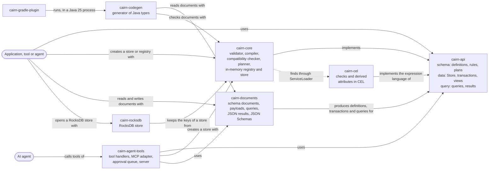

# Architecture overview

This page describes the system as it is now, using the [arc42](https://arc42.org/overview) section numbering, trimmed. Diagrams follow the [C4 model](https://c4model.com/) and are written as Mermaid flowcharts, which GitHub and Obsidian both render. Mermaid's dedicated C4 syntax is still experimental.
It is a living document: update it in the same pull request that changes the architecture, and bump `last-reviewed`.

> [!NOTE]
> **Current state:** the schema API is built: defining, validating, planning, registering and evolving types (the `type-model` and `schema-evolution` capabilities), and schema documents (`schema-documents`). Entities and relationships are stored in memory with history on two time axes (`transactions`, `entity-versions`, `views`, `relationships`), and Java rules run at commit, and again when a transaction changes what they read (`entity-rules`), as do checks in CEL that types declare, through the optional module `cairn-cel` (`checks`), which also computes derived attributes at commit and stores them with their versions (`derived-attributes`). Payloads and JSON results for agents are in `cairn-documents` (`json-payloads`), and `cairn-agent-tools` serves a store to agents as tools of the Model Context Protocol, under an approval policy (`agent-tools`). Java types are generated from schema documents by `cairn-codegen` and the Gradle plugin in `cairn-gradle-plugin` (`java-types`). Stores can be kept on disk through a commit log and snapshot files, and recover after a restart or a crash (`durability`). Views run queries: filters, follow steps, traversals (to the end, or to a maximum depth), grouping and aggregates, from every entity of a type or from given entities, built in Java, with generated types or as JSON (`queries`). Entities can be purged from all of history, for legal erasure, named by ID or by unique key (`purge`). Attributes can be classified, and views, queries and commits restricted to a clearance that withholds the rest, in Java and for agents (`attribute-access`). A change feed gives what each basis changed, read from a basis or subscribed to, in Java and through an agent tool (`change-feed`). Data is kept as keys and values in an ordered key-value store inside the engine ([ADR-0027](../decisions/0027-encode-bitemporal-data-as-keys-over-an-ordered-key-value-interface.md)), in memory, or in RocksDB in `cairn-rocksdb`, whose stores keep everything as keys and pass the same scenario tests ([ADR-0028](../decisions/0028-keep-a-store-in-rocksdb-with-its-metadata-as-keys-and-its-write-ahead-log-as-the-commit-log.md)). The intended design is in accepted ADRs, listed under [solution strategy](#4-solution-strategy), and explored in the [API research note](../research/2026-10-12-graph-system-of-record-api.md) and the [AI-native research note](../research/2026-10-13-ai-native-schema-and-rules.md). Write "n/a" for sections that do not apply yet instead of deleting them.
> Split a section into its own file in this folder when it outgrows a screen, and link it from here.

## 1. Introduction and goals

<!-- Link the product overview; list the three to five quality goals that drive the architecture, in priority order. -->

| Priority | Quality goal | Scenario that makes it measurable |
| --- | --- | --- |
| 1 | *tbd* | *tbd* |

## 2. Constraints

<!-- Technical, organizational and regulatory constraints. Link the ADR that introduced each one. -->

- Implementation language: Java 25, see [ADR-0005](../decisions/0005-choose-primary-implementation-language.md). Built with Gradle, see [ADR-0015](../decisions/0015-build-the-java-code-with-gradle.md). CI also runs the build on the newest Java release, without blocking.

## 3. Context and scope

<!-- C4 level 1: the system, its users and the external systems it talks to. -->


Cairn runs inside the application's JVM ([ADR-0007](../decisions/0007-run-sysrec-as-an-embedded-single-node-engine-with-a-single-writer.md)). It has no external systems yet.
AI agents reach it through text formats over the same API ([ADR-0017](../decisions/0017-design-cairn-so-that-ai-agents-are-first-class-users.md)): schema documents, transaction payloads, queries, JSON results and JSON Schemas, in `cairn-documents`. `cairn-agent-tools` serves these to agents as tools of the Model Context Protocol, either embedded in an application or as a server on standard input and output; see the guide [Serve a store to AI agents](../guides/serve-a-store-to-ai-agents.md).

## 4. Solution strategy

<!-- The handful of fundamental choices (style, stack, key patterns), each linking to its ADR. -->

Accepted, and built one change at a time:

- An embedded engine on one node, with a single writer and snapshot readers: [ADR-0007](../decisions/0007-run-sysrec-as-an-embedded-single-node-engine-with-a-single-writer.md)
- History on two time axes, effective time and transaction time: [ADR-0008](../decisions/0008-record-history-on-two-time-axes-effective-time-and-transaction-time.md)
- Versions of whole entities: [ADR-0009](../decisions/0009-version-whole-entities-rather-than-single-attributes.md)
- A typed property graph with single inheritance and traits: [ADR-0010](../decisions/0010-model-data-as-a-typed-property-graph-with-single-inheritance-and-traits.md)
- Storage behind an ordered key-value store and a commit log, with the in-memory implementation as the reference: [ADR-0011](../decisions/0011-hide-storage-behind-an-ordered-key-value-store-and-a-commit-log.md)
- Bitemporal data encoded as keys over that interface: current timelines, history rows and indexes: [ADR-0027](../decisions/0027-encode-bitemporal-data-as-keys-over-an-ordered-key-value-interface.md)
- Stores kept in RocksDB, with their metadata as keys and its write-ahead log as the commit log: [ADR-0028](../decisions/0028-keep-a-store-in-rocksdb-with-its-metadata-as-keys-and-its-write-ahead-log-as-the-commit-log.md)
- Types defined in schema documents, with Java types generated from them: [ADR-0012](../decisions/0012-define-types-as-annotated-java-interfaces-processed-at-compile-time.md)
- AI agents as first-class users: [ADR-0017](../decisions/0017-design-cairn-so-that-ai-agents-are-first-class-users.md)
- Declarative constraints, plus validation rules written in Java: [ADR-0018](../decisions/0018-validate-with-declarative-constraints-and-named-java-rules.md)
- Derived attributes from a version's own values in CEL, computed at commit and stored: [ADR-0031](../decisions/0031-derive-attributes-from-a-version-s-own-values-in-cel-computed-at-commit-and-stored.md)
- Checks in CEL over one version, run by an optional module: [ADR-0030](../decisions/0030-write-checks-within-one-version-in-cel-evaluated-by-an-optional-module.md)
- Reads through immutable views; feature flags resolved by the caller: [ADR-0013](../decisions/0013-read-through-immutable-views-and-take-feature-flags-resolved-by-the-caller.md)
- Opaque entity IDs from one generator per store, UUIDv7 by default: [ADR-0019](../decisions/0019-identify-entities-by-opaque-ids-from-one-generator-per-store.md)
- Patterns written as I-Regexp and matched in linear time: [ADR-0020](../decisions/0020-write-attribute-patterns-as-i-regexp-and-match-them-in-linear-time.md)
- Purges that remove entities from all of history, the one exception to immutability: [ADR-0024](../decisions/0024-purge-entities-by-removing-them-from-all-of-history-and-record-that-a-purge-happened.md)
- Queries as data, a pipeline of steps over named bindings: [ADR-0023](../decisions/0023-express-queries-as-data-a-pipeline-of-steps-over-named-bindings-with-a-java-builder-and-a-json-form.md)
- Entities named and found by unique keys, resolved at commit: [ADR-0026](../decisions/0026-refer-to-entities-by-unique-keys-resolved-at-commit.md)
- Rules that read the store as committed before the transaction: [ADR-0032](../decisions/0032-let-rules-read-the-store-as-committed-before-the-transaction.md)
- Purges that name entities by unique keys, resolved over all of effective time: [ADR-0033](../decisions/0033-name-entities-to-purge-by-unique-keys-that-resolve-over-all-of-effective-time.md)
- Relationships that outlive their targets, as records of past facts: [ADR-0034](../decisions/0034-let-relationships-of-a-type-outlive-their-targets-as-records-of-past-facts.md)
- Classified attributes, read and written through a clearance: [ADR-0036](../decisions/0036-classify-attributes-and-read-and-write-them-through-a-clearance-that-withholds-the-rest.md)
- Functions of Cairn's own in expressions, starting with counts of days: [ADR-0035](../decisions/0035-give-expressions-functions-of-cairn-s-own-over-a-version-s-values-starting-with-counts-of-days.md)
- Rules run again when the data they read changes: [ADR-0025](../decisions/0025-run-a-rule-again-when-the-data-it-read-changes.md)
- A change feed from an index of what each basis changed, read from a basis: [ADR-0029](../decisions/0029-feed-changes-from-an-index-of-what-each-basis-changed-read-from-a-basis.md)
- Durable stores through a commit log of effects and snapshot files: [ADR-0022](../decisions/0022-make-stores-durable-with-a-commit-log-of-effects-and-snapshots.md)
- Generated Java types as interfaces with snapshot records, builders of writes and rule base classes: [ADR-0021](../decisions/0021-generate-java-types-as-interfaces-with-snapshot-records-builders-of-writes-and-rule-base-classes.md)

## 5. Building block view

<!-- C4 level 2: containers and main components. Map each to the capabilities in openspec/specs it implements. -->

| Building block | Responsibility | Capabilities (specs) |
| --- | --- | --- |
| `cairn-api` | Public types: schema definitions and their builders, the resolved schema with descriptions, constraints and rule references, rule descriptors, problems with their details, explained codes and document locations, plans, stored definitions, identifiers, origins, submissions (who and why of a schema change) and the `SchemaRegistry` interface (package `schema`); stores and durable stores, transactions and their writes, receipts, IDs and unique keys, effective periods, views and entity states, relationship states, links and traversal steps, the rule interfaces `Rule`, `EntityRule`, `RelationshipRule` and `RuleContext`, and what generated types build on: `TypedEntity`, `TypedRelationship` and `TypedValues` (package `data`); queries, their results and typed references (package `query`). No dependencies. Its test fixtures hold the reference domain model, its rules, stories and queries, and a settable test clock. The change feed's types: `Change` with its kinds `TransactionChange`, `SchemaChange` and `PurgeChange`, and `Changed`. The `Check` of a type definition, and the package `expressions`: the interface of an expression language that compiles and evaluates checks ([ADR-0030](../decisions/0030-write-checks-within-one-version-in-cel-evaluated-by-an-optional-module.md)). Attributes may be `derived`, and the package `expressions` also compiles derivations (`CompiledDerivation`, [ADR-0031](../decisions/0031-derive-attributes-from-a-version-s-own-values-in-cel-computed-at-commit-and-stored.md)). `Clearance`, views restricted to one, and states that list their withheld values ([ADR-0036](../decisions/0036-classify-attributes-and-read-and-write-them-through-a-clearance-that-withholds-the-rest.md)). | `type-model`, `schema-evolution`, `schema-documents`, `transactions`, `entity-versions`, `views`, `entity-rules`, `relationships`, `java-types`, `queries`, `change-feed`, `checks`, `derived-attributes`, `attribute-access` |
| `cairn-core` | The engine. Validates definitions against each other and the available rules, compiles them into a resolved schema with schema identifiers, checks compatibility, plans registrations, checks and matches patterns (I-Regexp, with RE2/J), and keeps the in-memory schema registry with its history. Runs the in-memory store: one writer resolves the unique keys that writes name, at the start of each write's period, then applies and validates transactions against the state they would produce, ends composition targets with their sources, and the targets' other relationships, checks relationships at both ends (types, lifetimes, multiplicities, duplicates), letting relationships of types that outlive their targets continue after their targets end ([ADR-0034](../decisions/0034-let-relationships-of-a-type-outlive-their-targets-as-records-of-past-facts.md)), runs the Java rules that changed entities and relationships name, which read that state, and the state committed before the transaction, through read-only views, records what each rule read, and runs a rule again for the versions whose reads a transaction changes ([ADR-0025](../decisions/0025-run-a-rule-again-when-the-data-it-read-changes.md)), and writes each commit as one batch of keys to its ordered key-value store, as ADR-0027 lays them out: a current timeline per entity and relationship, history rows of segment versions with the bases that inserted and superseded them, and indexes of types, relationship ends and unique values, and a change key per changed entity or relationship for the change feed ([ADR-0027](../decisions/0027-encode-bitemporal-data-as-keys-over-an-ordered-key-value-interface.md)); views read, navigate, traverse and run queries at their basis without waiting, and give the last version of a target that a relationship outlives, reading current timelines in one lookup, older bases from history rows, and listings, navigation and unique keys from the indexes, while the writer checks uniqueness through the index of unique values; a query is checked against the view's schema first, then its steps scan and join in memory, and its rows are ordered by the query, then by IDs, so that every store returns them alike. Purges resolve the unique keys they name over all of effective time, refusing a key that several entities held ([ADR-0033](../decisions/0033-name-entities-to-purge-by-unique-keys-that-resolve-over-all-of-effective-time.md)), then remove entities, their relationships and composition targets from every basis, under the writer lock, and keep a record ([ADR-0024](../decisions/0024-purge-entities-by-removing-them-from-all-of-history-and-record-that-a-purge-happened.md)). Finds rules through `ServiceLoader` when asked. A durable store wraps the same in-memory store: it writes each commit's effects to a commit log in its directory, forced to disk before the commit is published, writes snapshot files without stopping commits, and recovers from the newest valid snapshot file and the log after it, without validating or running rules, then runs its rules once to learn what they read ([ADR-0022](../decisions/0022-make-stores-durable-with-a-commit-log-of-effects-and-snapshots.md)). A store over a persistent key-value store runs the same in-memory store over it, and writes the schema registrations, transaction records, receipts of idempotency keys and purge records as keys in the same batch as each commit's state ([ADR-0028](../decisions/0028-keep-a-store-in-rocksdb-with-its-metadata-as-keys-and-its-write-ahead-log-as-the-commit-log.md)). Exports only `SchemaRegistries`, `Stores`, `StoreSettings` and `IdGenerators`, and its key-value interface with the factory of stores over a persistent one to `cairn-rocksdb` alone; everything else is internal. Its only runtime dependency is RE2/J ([ADR-0020](../decisions/0020-write-attribute-patterns-as-i-regexp-and-match-them-in-linear-time.md)). Each commit also writes a key per changed entity or relationship, with the effective periods it changed, which purges delete and recovery writes again; stores read their changes from these keys and their records, and serve subscriptions on virtual threads of their own, which a publication wakes ([ADR-0029](../decisions/0029-feed-changes-from-an-index-of-what-each-basis-changed-read-from-a-basis.md)). Finds an expression language through `ServiceLoader` or the settings, compiles the checks of a schema per concrete type at registration, and runs them on every written segment after the declarative constraints and before rules; without a language it rejects checks. Compiles derived attributes with the same language, and computes them for every written segment before constraints, checks and rules, storing the results with the versions ([ADR-0031](../decisions/0031-derive-attributes-from-a-version-s-own-values-in-cel-computed-at-commit-and-stored.md)). Restricts views to a clearance through one wrapping view that every store shares, refuses queries, keys and writes over withheld attributes with `ACCESS_DENIED` before reading or resolving anything, validates classifications (`INVALID_CLASSIFICATION`), and keeps the classifications of definitions and the clearances of transactions in trailing sections of their records ([ADR-0036](../decisions/0036-classify-attributes-and-read-and-write-them-through-a-clearance-that-withholds-the-rest.md)). | `type-model`, `schema-evolution`, `transactions`, `entity-versions`, `views`, `entity-rules`, `relationships`, `durability`, `queries`, `purge`, `change-feed`, `checks`, `derived-attributes`, `attribute-access` |
| `cairn-rocksdb` | The RocksDB store ([ADR-0028](../decisions/0028-keep-a-store-in-rocksdb-with-its-metadata-as-keys-and-its-write-ahead-log-as-the-commit-log.md)): `RocksDbStores.open` takes the lock of a directory and opens a RocksDB database in its subdirectory `rocksdb`, behind `cairn-core`'s persistent key-value interface. Applies each batch with a synchronous write to RocksDB's write-ahead log, reads keys and ranges through iterators, and for purges flushes, compacts the whole database and opens it again, so that no file keeps the purged data. Depends on `cairn-core` and the RocksDB Java library, which bundles the native library; `cairn-core`'s scenario tests run against it too. | `durability`, `purge` |
| `cairn-cel` | The expression language of checks and derived attributes ([ADR-0030](../decisions/0030-write-checks-within-one-version-in-cel-evaluated-by-an-optional-module.md)): compiles a check with Google's CEL for Java against a type `self` with one typed field per attribute, reports errors with their positions, and evaluates it over a version's values with at most 10,000 evaluation steps; compiles derivations against the expected result type and converts their results to the attribute's values. Both may call functions of Cairn's own, `cairn.calendarDays` and `cairn.workingDays`, which count in UTC ([ADR-0035](../decisions/0035-give-expressions-functions-of-cairn-s-own-over-a-version-s-values-starting-with-counts-of-days.md)). Found through `ServiceLoader`; runs on the class path only, because CEL's jars cannot be named modules. Depends on `cairn-api` and `dev.cel:cel`, which brings Guava, protobuf-java and the ANTLR runtime. Derivations follow [ADR-0031](../decisions/0031-derive-attributes-from-a-version-s-own-values-in-cel-computed-at-commit-and-stored.md). Reports the attributes of `self` that a derivation reads, so that the registry can require its classification ([ADR-0036](../decisions/0036-classify-attributes-and-read-and-write-them-through-a-clearance-that-withholds-the-rest.md)). | `checks`, `derived-attributes` |
| `cairn-documents` | Schema documents ([ADR-0012](../decisions/0012-define-types-as-annotated-java-interfaces-processed-at-compile-time.md)): reads YAML 1.2 (and JSON) strictly into an origin and a schema definition, locates every problem in the document, writes definitions as YAML or JSON, and publishes the JSON Schema of the format. Reads transaction payloads (YAML 1.2 or JSON) with their problems located in them, resolving the unique keys they name through an `IdLookup` to locate problems and type values, writes receipts, states, links, steps and problems as JSON, and generates JSON Schemas for the values of each type and for payloads. Reads queries (JSON or YAML) with located problems, publishes their JSON Schema, and writes query results as JSON. `NamedRules` finds the rules that documents name, and the closest common supertype of the types that name each, for the generator and the agent server. Depends on `cairn-api` and SnakeYAML Engine, not on `cairn-core`. Writes the changes of the change feed as JSON. Reads and writes the `checks` of type definitions, and locates their problems at the check's expression. Reads and writes the `derived` expression of attributes and locates its problems; generated values schemas mark derived attributes read-only, and payload schemas leave them out of writes. Reads and writes the `classification` of attributes, and JSON results list the `withheld` attributes of states read through a restricted view ([ADR-0036](../decisions/0036-classify-attributes-and-read-and-write-them-through-a-clearance-that-withholds-the-rest.md)). | `schema-documents`, `json-payloads`, `queries`, `derived-attributes`, `attribute-access` |
| `cairn-codegen` | The generator of Java types ([ADR-0021](../decisions/0021-generate-java-types-as-interfaces-with-snapshot-records-builders-of-writes-and-rule-base-classes.md)): reads schema documents, checks them together in an in-memory schema registry, and writes an interface for every type, with a typed reference per attribute, a snapshot record and builders for entity and relationship types, and a base class for every rule the documents name, and a `by<Attribute>` method per unique attribute that makes a unique key. Runs from the command line. The code it generates depends on `cairn-api` only (`TypedEntity`, `TypedRelationship`, `TypedValues`). Depends on `cairn-documents` and `cairn-core`. It validates documents with a schema registry, so documents that declare checks or derived attributes need `cairn-cel` on its class path; generated builders have no setters for derived attributes. The accessors of classified attributes fail, naming the attribute, when the state withheld it ([ADR-0036](../decisions/0036-classify-attributes-and-read-and-write-them-through-a-clearance-that-withholds-the-rest.md)). | `java-types`, `derived-attributes`, `attribute-access` |
| `cairn-gradle-plugin` | The Gradle plugin `io.github.enricoag1982.cairn.types`: generates a project's types before its Java code compiles, by running `cairn-codegen` on Java 25 in a process of its own. Compiled for Java 17, the oldest Java that runs Gradle 9, with no dependency on Cairn's classes. | `java-types` |
| `cairn-agent-tools` | The adapter for AI agents ([ADR-0017](../decisions/0017-design-cairn-so-that-ai-agents-are-first-class-users.md)): `AgentTools` holds one handler per tool, reading and committing through the server's clearance ([ADR-0036](../decisions/0036-classify-attributes-and-read-and-write-them-through-a-clearance-that-withholds-the-rest.md)), taking and returning JSON text over a store, and `McpAdapter` registers them with the MCP Java SDK's server. `AgentPolicy` says whether an agent's registrations and commits are allowed, wait in the `ApprovalQueue` for a person, or are denied. The adapter records its principal on every transaction. `CairnAgentServer` runs an in-memory store from schema documents over standard input and output. Depends on `cairn-core`, `cairn-documents` and the MCP Java SDK, which brings Jackson, Reactor, SLF4J and a JSON Schema validator into this subproject only. It runs on the class path, because the SDK's jars have no valid module names: its internals are package-private, and it is trusted to use only what `cairn-core` exports, which the module system does not enforce there. `cairn_list_changes` reads the change feed from a basis. Its server includes `cairn-cel` at run time, so documents may declare checks and derived attributes. | `agent-tools`, `attribute-access` |
| `cairn-example-hr` | An example application and the end-to-end test of the platform: the [HR domain](../reference/hr-domain.md), with its schema document, generated types, Java rules and data, built on the public API. Depends on `cairn-api` and `cairn-documents`; its tests also use `cairn-core` and `cairn-agent-tools`. Its schema document declares the check `leave-dates-in-order` and derives a person's `fullName` and a leave's `days`, the latter with `cairn.workingDays`, so `cairn-cel` is on its generator's and tests' class paths. Pay is classified `pay`, so the org-chart agent of HR-18 reads employments without it. | none |
| `build-logic` | Gradle convention plugins ([ADR-0015](../decisions/0015-build-the-java-code-with-gradle.md)): `cairn.java-library` for every Java module, `cairn.reference-domain-tests` and `cairn.hr-domain-tests` for modules whose tests read the reference domain page or its schema document, or the HR domain page, `cairn.gradle-plugin` for Gradle plugins (Java 17, TestKit tests with the generator's class path), `cairn.reference-types`, which generates the reference domain's types for typed tests, `cairn.generated-types`, which generates a project's types from its own schema documents, as the Gradle plugin does for applications, `cairn.rocksdb-tests` for modules whose tests open RocksDB stores (native access, and the class path for a forked process), and `cairn.rocksdb-conformance`, whose task `rocksdbConformanceTest`, part of `check`, runs named test classes again with the system property `cairn.test.backend=rocksdb`, so that the test fixtures build RocksDB stores. Modules with a `module-info.java` get their whole compile classpath as module path, so that automatic modules such as RE2/J are found; `cairn-agent-tools`, `cairn-gradle-plugin` and `cairn-cel` have none and stay on the class path. | none |



## 6. Runtime view

<!-- Sequence diagrams for the few flows that matter most. -->

A commit, in the in-memory store ([ADR-0007](../decisions/0007-run-sysrec-as-an-embedded-single-node-engine-with-a-single-writer.md), [ADR-0008](../decisions/0008-record-history-on-two-time-axes-effective-time-and-transaction-time.md)):

```mermaid
sequenceDiagram
    participant C as Caller
    participant S as Store (writer lock)
    participant Q as Commit sequence
    participant V as View
    C->>S: commit(transaction)
    S->>S: idempotency key already used? return its receipt
    S->>Q: next() basis and transaction time (not advanced yet)
    S->>S: resolve unique keys against the committed state, at the start of each write's period
    S->>S: apply writes to working timelines, IDs from a copy of the generator
    S->>S: end composition targets with their sources, and the targets' other relationships, but not those that outlive them (cascades)
    S->>S: compute the derived attributes of every written segment
    S->>S: validate values and check relationships at both ends, at every point in effective time, or where it starts for a target that a relationship outlives
    S->>S: run the checks of their types on every changed segment
    S->>S: run the rules of changed entities and relationships on read-only views of that state and of the store as committed before it, recording what they read
    S->>S: if no other problems, run rules again for versions whose reads the transaction changes (re-checks)
    alt problems
        S-->>C: Rejected(problems), nothing recorded
    else valid
        opt durable store kept in a directory
            S->>S: append the commit's effects to the commit log and force it to disk
        end
        S->>S: write the commit's keys as one batch (current timelines, history rows, markers, indexes, change keys; in a RocksDB store also its records, written synchronously), keep the generator copy
        S->>Q: publish(commit), which wakes the change-feed subscriptions
        S-->>C: Committed(receipt)
    end
    C->>S: view(coordinates)
    S-->>V: a view pinned to a basis and its schema
    C->>V: reads
    V->>V: reads timelines at or below its basis, never waits
```

A dry run follows the same path and stops before writing: it records nothing, uses no basis, reserves no ID and leaves the reads of rules as they were. A commit replaces the reads of the versions its rules checked.
Opening a durable store recovers before the store is returned: it reads the newest valid snapshot file, applies the log records after it, drops what a crash left at the end of the log, checks that the ID generator accepts the recovered IDs, and resumes the commit sequence after the last basis and transaction time. Then it runs each rule it has code for once over every version whose type names it, to learn what the rule reads, without judging the results ([ADR-0025](../decisions/0025-run-a-rule-again-when-the-data-it-read-changes.md)). A store whose schema declares checks or derived attributes compiles them again with its expression language when it opens; derived values are recovered as they were stored, not computed again.
Opening a RocksDB store replays nothing of its own: RocksDB replays its write-ahead log, and the store reads its records back from their keys, checks the ID generator, resumes the commit sequence, finishes the compaction of a purge that did not return, and runs its rules once, as a durable store does ([ADR-0028](../decisions/0028-keep-a-store-in-rocksdb-with-its-metadata-as-keys-and-its-write-ahead-log-as-the-commit-log.md)).

## 7. Deployment view

<!-- Environments, infrastructure, how artifacts are built and released. -->

Cairn is a set of libraries that an application embeds, keeping its data in memory, in a directory ([guide](../guides/run-a-durable-store.md)) or in RocksDB ([guide](../guides/keep-a-store-in-rocksdb.md)), and a Gradle plugin that generates Java types at build time ([guide](../guides/generate-java-types.md)); nothing is released yet. The generator also runs from the command line, and the agent server is the one packaged program: `./gradlew :cairn-agent-tools:installDist` builds a start script and its jars, which an MCP client starts as a local process ([guide](../guides/serve-a-store-to-ai-agents.md)).

## 8. Cross-cutting concepts

<!-- Error handling, security, observability, persistence, configuration, testing strategy. -->

- **Errors:** bad data never throws. Registrations, plans, reading schema documents and payloads, commits and dry runs return a result that lists every problem, each with a stable code, a path and, where it helps, the expected value, the found value, a hint, its location in the document or payload and the code of the rule that reported it. A rule that fails is reported as a problem too. Agent tools never fail the protocol call for bad input: they return the problems as JSON, with `@arguments.<name>` as the path of a problem with an argument. Exceptions mean programming errors in the caller's code: a missing value, a blank temporary ID, a `Multiplicity` other than 0 or 1 to 1 or unbounded, listing a type or navigating or traversing by a name that the view's schema does not have, finding by a unique key that the schema does not allow, a negative traversal depth, asking for the JSON Schema of a type the schema does not have, the same rule given twice or a rule without a description, a rule that the service loader cannot load, or a write attempted from inside a rule; and reading a state as a generated type that it is not, or one that lacks a required value that it did not withhold, or has a value of another type. Commits report a check that is false as `CHECK_VIOLATED` and one that cannot be evaluated as `CHECK_FAILED`, a write that sets a derived attribute as `DERIVED_ATTRIBUTE_WRITTEN`, and a derivation that fails as `DERIVATION_FAILED`; registration reports `INVALID_CHECK` and `INVALID_DERIVATION`. Reading and running queries, and purges, return problems too; a `Purge` that names no entity, by ID or by key, or has a blank principal or reason throws, as a programming error, and so do finding by a unique key of an attribute that a restricted view withholds (`IllegalArgumentException`) and the accessor of a withheld attribute of a generated type (`IllegalStateException`); queries, keys and writes over withheld attributes are problems `ACCESS_DENIED`, and malformed or inconsistent classifications `INVALID_CLASSIFICATION`; query records throw only for a negative limit or depth, as programming errors. A durable store also throws when its files fail: an input or output error, a directory that another store holds, damage, an unknown format version, or an ID generator that does not accept the IDs it holds; after a failed write it refuses commits until it is opened again, and after `close` it refuses every call. A RocksDB store throws in the same cases, and for a directory that the other kind of store wrote; if reopening its database after a purge fails, it refuses every call but `close` until it is opened again.
- **Concurrency:** schema registrations and data commits of a store share one writer lock and one commit sequence (the single writer). Committed data is written as one batch and then published through the latest basis, so readers never lock and never see a partial commit at their own basis: every value carries the bases it belongs to. A subscription to the change feed reads changes on a virtual thread of its own, at its consumer's pace; publishing a basis wakes it without blocking the writer. Rules run on the writer thread, may only read, and must be thread-safe, because stores that share settings call them concurrently; the store refuses writes while rules run. A durable store forces each commit to disk while it holds the writer lock, so writers wait for the disk; it writes snapshot files from published state without the writer lock. A purge is the exception to readers never seeing a partial change: it takes the snapshot lock, then the writer lock, removes relationships before entities so that a single lookup never finds a relationship without its end, and in a durable store writes its snapshot file under both locks; a view reading during a purge may see part of it. A RocksDB store's reads take a shared gate of the database, never the writer lock: they wait only while a purge reopens the database after compacting, under both locks, or while the store closes, and a scan that is running goes on from its last key on the reopened database.
- **Security:** Cairn authenticates nobody: the application tells it who acts and with which *clearance* ([ADR-0036](../decisions/0036-classify-attributes-and-read-and-write-them-through-a-clearance-that-withholds-the-rest.md)). A view or transaction with a clearance withholds and protects the values of *classifications* it does not cover; one without reads and writes everything, so code acting for a user passes the user's clearance. Agents act as the principal their adapter is configured with, which every transaction records, read and write through the adapter's clearance, empty by default, and the approval policy decides what they may change on their own; an agent's schema change may not touch classifications its clearance does not cover. A view applies the classifications of the latest schema as well as its own, so reading at an older basis reveals nothing classified since. A transaction refused with `ACCESS_DENIED` runs no validation, check or rule, and the problems of a transaction with a clearance carry no withheld value. The problems of rules and checks, timelines and the change feed can still tell that something holds, exists or changed, and when. The agent server is for trusted, local use.
- **Time:** transaction times come from an injected clock, have microsecond precision and strictly increase, across schema and data transactions, and across the openings of a durable or RocksDB store, even if the clock went back. Effective periods are half-open UTC instants with microsecond precision.
- **Testing:** each spec scenario has one test whose display name is the scenario's name. `ReferenceModelTest` keeps the reference model fixture in step with the [reference domain](../reference/reference-domain.md), and `ReferenceModelDocumentTest` keeps its schema document in step with the fixture. `JsonSchemaDriftTest` keeps the published JSON Schema in step with the reader, and `TransactionSchemaTest` the generated payload schema with the payload reader. `EcmaScriptPatternsTest` checks that `cairn-documents` translates patterns as the engine does, and `ReferenceStoryPayloadsTest` that every reference story written as a payload is valid against the generated schema and reads back. `ReferenceStoriesTest` keeps `ReferenceStories` in step with the story table of the reference domain. `cairn-codegen` compiles the code it generates in its tests with all lint warnings as errors, and its typed tests use the reference domain's generated types against the in-memory store; `cairn-gradle-plugin` runs real builds with Gradle TestKit, one of them with Gradle on an older Java when the machine has Java 17 to 24. Durable stores are compared with in-memory twins that committed the same transactions, through every reference story and random operations, before and after reopening; their crash and damage tests cut, zero and alter the bytes of their files. The build runs the scenario tests of the store capabilities a second time against RocksDB stores (`rocksdbConformanceTest`); `cairn-rocksdb` compares RocksDB stores with in-memory twins at every basis after random operations, stops a forked process that committed without closing its store, and searches every file of a store's directory after a purge. The change feed is checked against what views at each basis and the basis before read, in every kind of store, before and after purges and reopening. `cairn-example-hr` tests the platform end to end, from outside, on the [HR domain](../reference/hr-domain.md): a fictional company built on the public API with a schema document, generated types, Java rules found through the service loader, payloads, queries, purges, a durable store, the agent tools and the change feed (HR-15), with stories replayed in recording order and a generated company of 40 employees. `ReferenceQueries` holds the reference domain's queries, which the builder, generated types and the JSON form must answer alike; `QuerySchemaDriftTest` keeps the query JSON Schema in step with the reader, and `QueryLiteralAgreementTest` the engine's reading of date and instant literals with the documents'. `AgentTaskSuiteTest` scripts what agents do through the tools only, using nothing but what the tools return, and one task goes through the MCP layer. Tests run with compact object headers on.

## 9. Architecture decisions

See the [decision log](../decisions/README.md). This page only links to ADRs; it never repeats their reasoning.

## 10. Quality requirements

<!-- Concrete quality scenarios beyond the top goals in section 1. Testable ones should become OpenSpec requirements. -->

## 11. Risks and technical debt

| Risk or debt | Impact | Mitigation or tracking issue |
| --- | --- | --- |
| A purge rewrites every file of a durable store, or compacts a whole RocksDB store, under the writer lock | Commits wait while a purge runs; results reported before a purge cannot always be reproduced after it | Purges are rare and privileged, and each leaves a purge record |
| Every commit of a durable or RocksDB store is forced to disk | Commits are as fast as the disk syncs | Grouping commits later, behind the same API ([ADR-0022](../decisions/0022-make-stores-durable-with-a-commit-log-of-effects-and-snapshots.md)) |
| Log and snapshot files hold whole timelines per basis | Their size grows with the square of an entity's number of versions | The key-value layout stores segment versions once ([ADR-0027](../decisions/0027-encode-bitemporal-data-as-keys-over-an-ordered-key-value-interface.md)); RocksDB stores keep that layout, without log or snapshot files ([ADR-0028](../decisions/0028-keep-a-store-in-rocksdb-with-its-metadata-as-keys-and-its-write-ahead-log-as-the-commit-log.md)) |
| Every commit rewrites the current timeline of what it changes, and the in-memory store decodes timelines on every read | Entities with very many versions make commits larger; the in-memory store is slower than with objects | A cache of decoded current timelines when measurements ask for it ([ADR-0027](../decisions/0027-encode-bitemporal-data-as-keys-over-an-ordered-key-value-interface.md)) |
| The reads of rules are kept in memory, not in files | Memory grows with what every version's last check read; a durable store runs every rule once when it opens, so opening slows as data grows | Keeping reads in files can follow without changing behavior ([ADR-0025](../decisions/0025-run-a-rule-again-when-the-data-it-read-changes.md)) |
| Rules run inside the single writer | A slow rule, or one that reads much data, slows every commit, also when a change elsewhere runs it again ([ADR-0018](../decisions/0018-validate-with-declarative-constraints-and-named-java-rules.md), [ADR-0025](../decisions/0025-run-a-rule-again-when-the-data-it-read-changes.md)) | Keep rules small; measure commit times with rules on a durable store before production use |
| People approve agents' requests only through the Java API | The standalone agent server cannot have requests approved; approval needs an application that embeds the adapter | A way for people to decide requests can follow in the server, with authentication |
| Generated code knows type names as of generation | `T.from(state)` reads a subtype registered later as the type the caller asks for; aliases of renamed types are not recognized | `T.from(state, schema)` reads it as its nearest known supertype ([ADR-0021](../decisions/0021-generate-java-types-as-interfaces-with-snapshot-records-builders-of-writes-and-rule-base-classes.md)); regenerate types after renames |
| Access control rests on the caller | A view or transaction without a clearance reads and writes every value; the problems of rules and checks can reveal that something holds | Pass a clearance in code that acts for a user; the agent server's clearance is empty by default; schema authors keep values out of messages ([ADR-0036](../decisions/0036-classify-attributes-and-read-and-write-them-through-a-clearance-that-withholds-the-rest.md)) |
| Queries read every entity of their start type, unless they start from given entities, and filter and join in memory | Queries over large stores are slow | Indexes of attribute values and query planning, on the key-value layout ([ADR-0011](../decisions/0011-hide-storage-behind-an-ordered-key-value-store-and-a-commit-log.md), [ADR-0027](../decisions/0027-encode-bitemporal-data-as-keys-over-an-ordered-key-value-interface.md)), without changing results |
| Views at older bases rebuild timelines from history rows, and the index of unique values keeps every value ever held | Old-basis reads are slower than latest ones; the index grows until a purge | Ranges that skip superseded rows when measured ([ADR-0027](../decisions/0027-encode-bitemporal-data-as-keys-over-an-ordered-key-value-interface.md)) |
| The change feed carries no values, and its index grows with every change | A consumer reads two views per change for values; storage grows as history rows do | Accepted by [ADR-0029](../decisions/0029-feed-changes-from-an-index-of-what-each-basis-changed-read-from-a-basis.md); filters by type can follow |
| Checks bring CEL's dependencies, and decimals become doubles in them | `cairn-cel` puts Guava and protobuf-java on an application's class path, whose versions can clash with the application's own; exact decimal comparisons are not possible in checks | The module is optional; exact comparisons stay Java rules ([ADR-0030](../decisions/0030-write-checks-within-one-version-in-cel-evaluated-by-an-optional-module.md)) |
| Derived values are stored | Changing a derived expression, or adding a derived attribute to a type with data, is breaking until migrations exist; derived decimals pass through doubles | Declare derived attributes with their type ([ADR-0031](../decisions/0031-derive-attributes-from-a-version-s-own-values-in-cel-computed-at-commit-and-stored.md)) |
| A RocksDB store keeps its schema history, transaction records, receipts of idempotency keys and purge records in memory too | Its memory grows with every commit, though entities and relationships are read from disk | Reading them from their keys when needed, later ([ADR-0028](../decisions/0028-keep-a-store-in-rocksdb-with-its-metadata-as-keys-and-its-write-ahead-log-as-the-commit-log.md)) |
| Purges in a RocksDB store rely on RocksDB writing a new MANIFEST when it opens a database | An upgrade of RocksDB that keeps old MANIFEST records could leave purged keys in a file | A test searches every file of the store right after a purge, so the build fails first |

## 12. Glossary

See the [glossary](../glossary.md).
