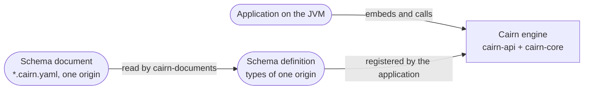
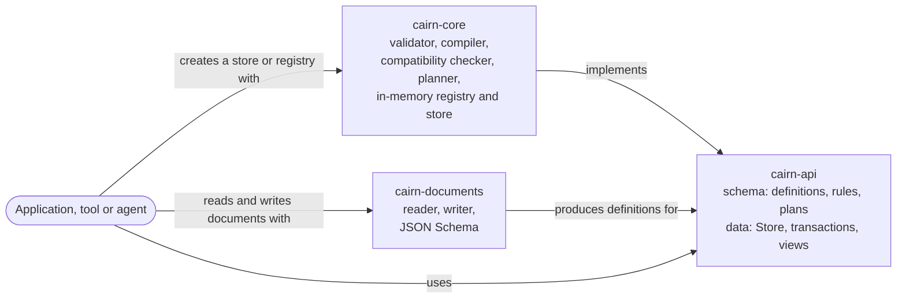
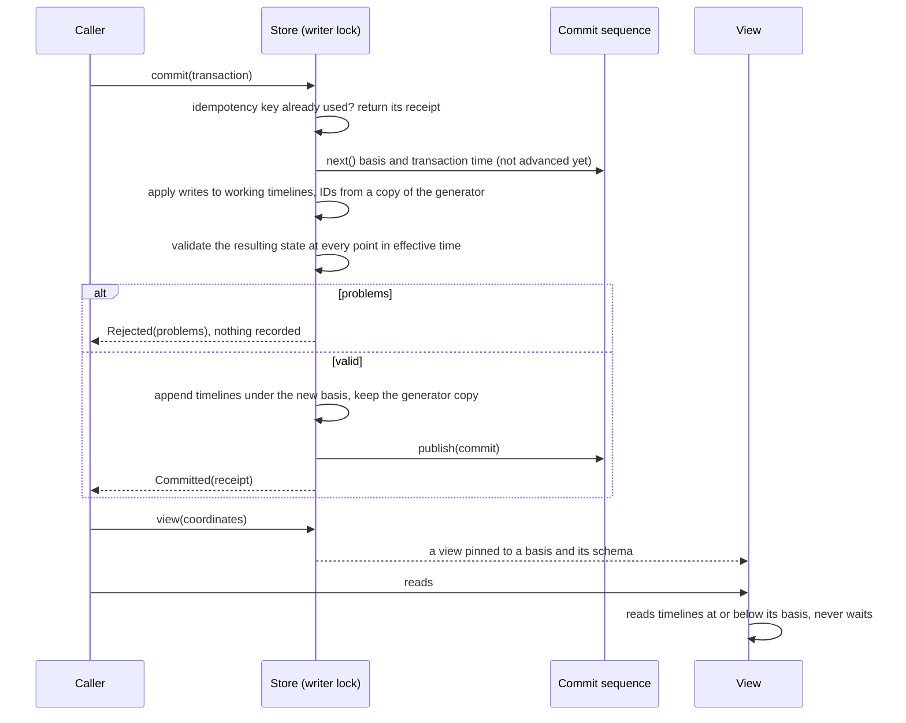

# Architecture overview

This page describes the system as it is now, using the [arc42](https://arc42.org/overview) section numbering, trimmed. Diagrams follow the [C4 model](https://c4model.com/) and are written as Mermaid flowcharts, which GitHub and Obsidian both render. Mermaid's dedicated C4 syntax is still experimental.
It is a living document: update it in the same pull request that changes the architecture, and bump `last-reviewed`.

> [!NOTE]
> **Current state:** the schema API is built: defining, validating, planning, registering and evolving types (the `type-model` and `schema-evolution` capabilities), and schema documents (`schema-documents`). Entities are stored in memory with history on two time axes (`transactions`, `entity-versions`, `views`). Relationships, rules at commit, durable storage and queries are not built yet. The intended design is in accepted ADRs, listed under [solution strategy](#4-solution-strategy), and explored in the [API research note](../research/2026-10-12-graph-system-of-record-api.md) and the [AI-native research note](../research/2026-10-13-ai-native-schema-and-rules.md). Write "n/a" for sections that do not apply yet instead of deleting them.
> Split a section into its own file in this folder when it outgrows a screen, and link it from here.

## 1. Introduction and goals

<!-- Link the product overview; list the three to five quality goals that drive the architecture, in priority order. -->

| Priority | Quality goal | Scenario that makes it measurable |
| --- | --- | --- |
| 1 | *tbd* | *tbd* |

## 2. Constraints

<!-- Technical, organizational and regulatory constraints. Link the ADR that introduced each one. -->

- Implementation language: Java 25, see [ADR-0005](../decisions/0005-choose-primary-implementation-language.md). Built with Gradle, see [ADR-0015](../decisions/0015-build-the-java-code-with-gradle.md). CI also runs the build on the newest Java release, without blocking.

## 3. Context and scope

<!-- C4 level 1: the system, its users and the external systems it talks to. -->

Cairn runs inside the application's JVM ([ADR-0007](../decisions/0007-run-sysrec-as-an-embedded-single-node-engine-with-a-single-writer.md)). It has no external systems yet.
AI agents are planned to reach it through tools over the same API ([ADR-0017](../decisions/0017-design-cairn-so-that-ai-agents-are-first-class-users.md)); nothing for them is built yet.

## 4. Solution strategy

<!-- The handful of fundamental choices (style, stack, key patterns), each linking to its ADR. -->

Accepted, and built one change at a time:

- An embedded engine on one node, with a single writer and snapshot readers: [ADR-0007](../decisions/0007-run-sysrec-as-an-embedded-single-node-engine-with-a-single-writer.md)
- History on two time axes, effective time and transaction time: [ADR-0008](../decisions/0008-record-history-on-two-time-axes-effective-time-and-transaction-time.md)
- Versions of whole entities: [ADR-0009](../decisions/0009-version-whole-entities-rather-than-single-attributes.md)
- A typed property graph with single inheritance and traits: [ADR-0010](../decisions/0010-model-data-as-a-typed-property-graph-with-single-inheritance-and-traits.md)
- Storage behind an ordered key-value store and a commit log, with the in-memory implementation as the reference: [ADR-0011](../decisions/0011-hide-storage-behind-an-ordered-key-value-store-and-a-commit-log.md)
- Types defined in schema documents, with Java types generated from them: [ADR-0012](../decisions/0012-define-types-as-annotated-java-interfaces-processed-at-compile-time.md)
- AI agents as first-class users: [ADR-0017](../decisions/0017-design-cairn-so-that-ai-agents-are-first-class-users.md)
- Declarative constraints, plus validation rules written in Java: [ADR-0018](../decisions/0018-validate-with-declarative-constraints-and-named-java-rules.md)
- Reads through immutable views; feature flags resolved by the caller: [ADR-0013](../decisions/0013-read-through-immutable-views-and-take-feature-flags-resolved-by-the-caller.md)
- Opaque entity IDs from one generator per store, UUIDv7 by default: [ADR-0019](../decisions/0019-identify-entities-by-opaque-ids-from-one-generator-per-store.md)
- Patterns written as I-Regexp and matched in linear time: [ADR-0020](../decisions/0020-write-attribute-patterns-as-i-regexp-and-match-them-in-linear-time.md)

## 5. Building block view

<!-- C4 level 2: containers and main components. Map each to the capabilities in openspec/specs it implements. -->

| Building block | Responsibility | Capabilities (specs) |
| --- | --- | --- |
| `cairn-api` | Public types: schema definitions and their builders, the resolved schema with descriptions, constraints and rule references, rule descriptors, problems with their details, explained codes and document locations, plans, stored definitions, identifiers, origins and the `SchemaRegistry` interface (package `schema`); stores, transactions and their writes, receipts, IDs, effective periods, views and entity states (package `data`). No dependencies. Its test fixtures hold the reference domain model, its rules and stories, and a settable test clock. | `type-model`, `schema-evolution`, `schema-documents`, `transactions`, `entity-versions`, `views` |
| `cairn-core` | The engine. Validates definitions against each other and the available rules, compiles them into a resolved schema with schema identifiers, checks compatibility, plans registrations, checks and matches patterns (I-Regexp, with RE2/J), and keeps the in-memory schema registry with its history. Runs the in-memory store: one writer applies and validates transactions against the state they would produce and appends a timeline per entity and basis, and views read at their basis without waiting. Exports only `SchemaRegistries`, `Stores`, `StoreSettings` and `IdGenerators`; everything else is internal. Its only runtime dependency is RE2/J ([ADR-0020](../decisions/0020-write-attribute-patterns-as-i-regexp-and-match-them-in-linear-time.md)). | `type-model`, `schema-evolution`, `transactions`, `entity-versions`, `views` |
| `cairn-documents` | Schema documents ([ADR-0012](../decisions/0012-define-types-as-annotated-java-interfaces-processed-at-compile-time.md)): reads YAML 1.2 (and JSON) strictly into an origin and a schema definition, locates every problem in the document, writes definitions as YAML or JSON, and publishes the JSON Schema of the format. Depends on `cairn-api` and SnakeYAML Engine, not on `cairn-core`. | `schema-documents` |
| `build-logic` | Gradle convention plugins ([ADR-0015](../decisions/0015-build-the-java-code-with-gradle.md)): `cairn.java-library` for every Java module, and `cairn.reference-domain-tests` for modules whose tests read the reference domain page or its schema document. Modules with a `module-info.java` get their whole compile classpath as module path, so that automatic modules such as RE2/J are found. | none |

## 6. Runtime view

<!-- Sequence diagrams for the few flows that matter most. -->

A commit, in the in-memory store ([ADR-0007](../decisions/0007-run-sysrec-as-an-embedded-single-node-engine-with-a-single-writer.md), [ADR-0008](../decisions/0008-record-history-on-two-time-axes-effective-time-and-transaction-time.md)):

A dry run follows the same path and stops before appending: it records nothing, uses no basis and reserves no ID.

## 7. Deployment view

<!-- Environments, infrastructure, how artifacts are built and released. -->

## 8. Cross-cutting concepts

<!-- Error handling, security, observability, persistence, configuration, testing strategy. -->

- **Errors:** an invalid schema definition never causes an exception. Registrations, plans, document reading, commits and dry runs return a result that lists every problem, each with a stable code, a path and, where it helps, the expected value, the found value, a hint and its location in the document. Bad data never throws. Exceptions mean programming errors in the caller's code: a missing value, a blank temporary ID, listing a type the view's schema does not have, or a registry given the same rule twice. Exceptions mean programming errors: a missing value, a `Multiplicity` other than 0 or 1 to 1 or unbounded, or a registry given the same rule twice.
- **Concurrency:** schema registrations and data commits of a store share one writer lock and one commit sequence (the single writer). Committed data is appended and then published through the latest basis, so readers never lock and never see a partial commit.
- **Time:** transaction times come from an injected clock, have microsecond precision and strictly increase, across schema and data transactions. Effective periods are half-open UTC instants with microsecond precision.
- **Testing:** each spec scenario has one test whose display name is the scenario's name. `ReferenceModelTest` keeps the reference model fixture in step with the [reference domain](../reference/reference-domain.md), and `ReferenceModelDocumentTest` keeps its schema document in step with the fixture. `JsonSchemaDriftTest` keeps the published JSON Schema in step with the reader. `ReferenceStories` follows the story table of the reference domain by hand; no test checks it yet. Tests run with compact object headers on.

## 9. Architecture decisions

See the [decision log](../decisions/README.md). This page only links to ADRs; it never repeats their reasoning.

## 10. Quality requirements

<!-- Concrete quality scenarios beyond the top goals in section 1. Testable ones should become OpenSpec requirements. -->

## 11. Risks and technical debt

| Risk or debt | Impact | Mitigation or tracking issue |
| --- | --- | --- |
| *tbd* | | |

## 12. Glossary

See the [glossary](../glossary.md).
